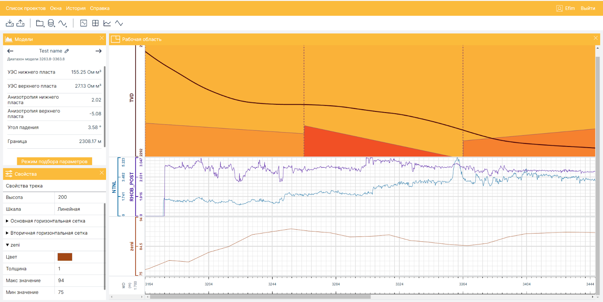
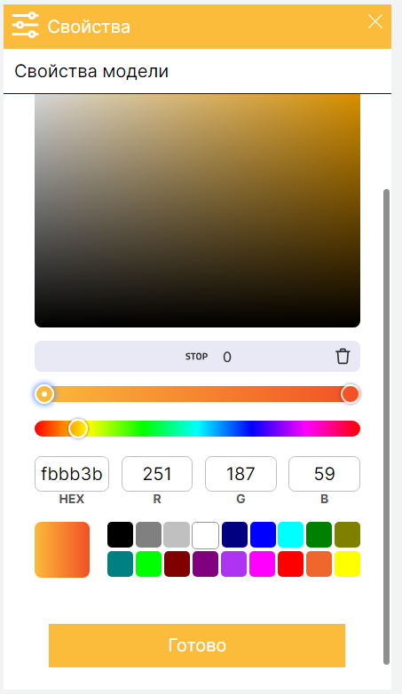
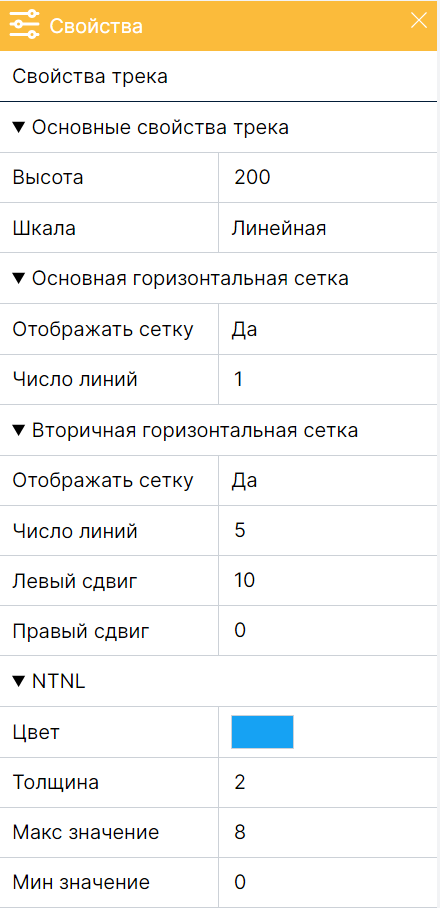
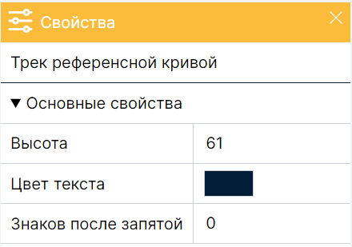

# Geodrilling
Приложение GeoDrilling – это Web-приложение для обучения интерпретации сигналов забойной телеметрии. Оно предоставляет основные программные средства, используемые инженерами для определения модели околоскважинного пространства, в том числе средства для количественной интерпретации данных высокочастотного электромагнитного зондирования, измеренных с помощью прибора ВИКПБ. Также GeoDrilling предоставляет возможность догрузки данных, как это бывает при настоящем бурении и предоставляет минимальный функционал для передачи проекта от преподавателя к ученику и обратно. 

